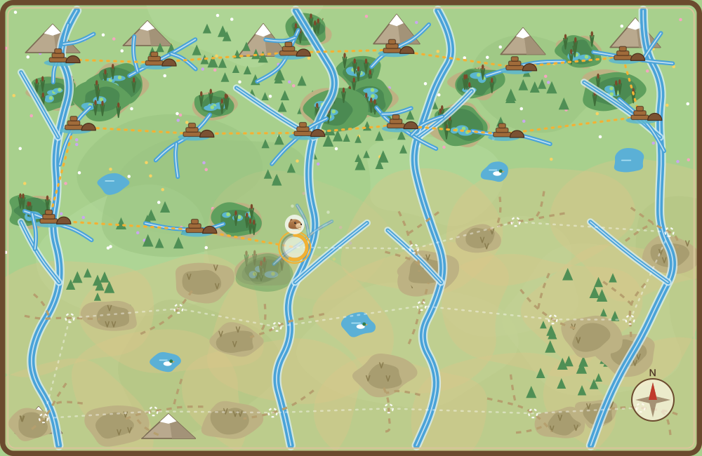
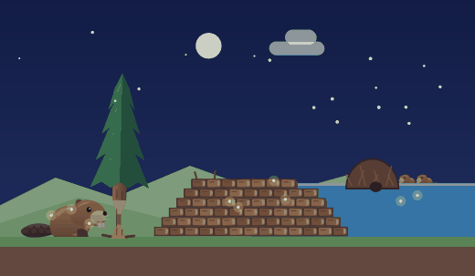

# Beaver Dam

**A little beaver lives in your sidebar. The more you code, the bigger his dam gets. Help him restore his ecosystem!**


For Visual Studio Code and [Positron](https://positron.posit.co/).

Type code and he chews a tree, hauls logs and builds a dam. A pond rises behind it, a lodge appears, baby beavers paddle around, and if the dam gets bigger visitors might drop by. Every finished dam brings a stream on the world map back to life.

## Installation

##### From a vsix file

1. Download `beaver-dam-<version>.vsix` from the [latest release]().
2. **Option 1 – Using the Command Palette:** Press  **Ctrl + Shift + P** , search for  **Extensions: Install from VSIX...** , and select it. Then choose the downloaded `<span>.vsix</span>` file.
3. **Option 2 – Using the Extensions view:** Open the Extensions view, click the `<span>...</span>` menu in the top right, choose  **Install from VSIX...** , and select the file.
4. Run **Developer: Reload Window** from the Command Palette to activate the extension.

##### From source

```bash
git clone https://github.com/MarcelKnobloch/beaver-buddy.git
cd beaver-buddy
npm install
npx @vscode/vsce package      # creates beaver-dam-<version>.vsix
```

Then install the `.vsix` as above, or open the folder in the editor and press `F5` to run it in a development window.

## Getting started

Open the **Explorer** sidebar (the files icon). The beaver lives in the **Beaver Buddy** section at the bottom.
If you cannot see it, right-click the Explorer header and tick *Beaver Buddy*. You can drag the section into the secondary sidebar to keep him in view next to your code.

## Features

##### He works while you work

Every character you type (or delete) is a bite. Enough bites make a log, and he carries each log to the dam.
He says **hello :)** when the editor starts and **bye :)** when it shuts down.

##### Visitors

Birds land on the dam once it is about a third built. When the lodge is up, a small otter swims by every now and then.

##### A world map to restore

The **World** tab shows 30 dry streams feeding four big rivers. Each finished dam sends water down its stream, brings the swamp at its end back to life and turns the dry land around it into meadow. Hover a site to see its name. **Open map in editor** shows it large.



##### Day and night

The sky follows your local clock: sunrise, day, sunset, then a starry night with fireflies. The little button in the
corner of the scene switches between *follows my clock*, *always day* and *always night*, with a quick sunset or
sunrise in between.



##### Idle behaviour

- **He keeps working when you stop.** While the editor window is focused but you are not typing he chews slowly (about one log every five minutes) and now and then climbs up to rest on top of the dam. Nothing happens while the window is in the background.
- **Progress is saved** between sessions.

## Commands

Open the Command Palette (`Ctrl+Shift+P` / `Cmd+Shift+P`) and type "Beaver".

| Command                                          | What it does                                                                                                |
| ------------------------------------------------ | ----------------------------------------------------------------------------------------------------------- |
| **Beaver: Say hello**                      | Say hello.                                                                                                  |
| **Beaver: Say bye**                        | Say bye.                                                                                                    |
| **Beaver: Open world map**                 | Open the world map large, in an editor tab.                                                                 |
| **Beaver: Celebrate (yay)**                | Make him cheer (confetti and "yay :)"). Handy for trying the animation.                                     |
| **Beaver: Invite visitors (birds, otter)** | Ask the visitors (birds and the otter) to drop by right now. Otters appear only if the dam is a big enough. |
| **Beaver: Rest on the dam**                | Make the beaver climb up and rest on top of the dam.                                                        |
| **Beaver: Show run detection log**         | Open the log that explains why a task, terminal command or run did or did not count as a run.               |
| **Beaver: Switch day / night**             | Cycle the sky: follows your clock, always day, always night.                                                |
| **Beaver: Reset progress**                 | Reset all progress (logs, dams and the world map).                                                          |

## Settings

| Setting                         | Default                                         | Description                                                                                                                                                                                       |
| ------------------------------- | ----------------------------------------------- | ------------------------------------------------------------------------------------------------------------------------------------------------------------------------------------------------- |
| `beaverDam.charsPerLog`       | `30`                                          | Typed (or deleted) characters it takes to gather one log.                                                                                                                                         |
| `beaverDam.logsPerDam`        | `80`                                          | Logs needed to finish one dam. Bigger dams zoom the camera out further.                                                                                                                           |
| `beaverDam.idleWorkPercent`   | `3`                                           | How fast he works while you are not typing, as a percentage of a typical coding pace. `3` is about one log every 5 minutes. `0` turns idle work off. Only counts while the window is focused. |
| `beaverDam.timeOfDay`         | `real`                                        | `real` follows your local clock, `fast` runs a whole day in 8 minutes, `day` and `night` stay put. The button in the scene changes this too.                                              |
| `beaverDam.runPattern`        | see Settings                                    | Regular expression that decides which terminal commands and tasks count as running your code (Python, R, Quarto, pytest, make, ...).                                                              |
| `beaverDam.celebrate`         | `['script', 'notebook', 'terminal', 'tasks']` | Which finished runs make him cheer: `script` (Positron Run File / Source), `notebook`, `console` (every console line), `terminal`, `tasks`.                                             |
| `beaverDam.reactToFailedRuns` | `true`                                        | Say "oops :(" when a run ends in an error.                                                                                                                                                        |

## Contributing

Bug reports, ideas and pull requests are welcome, see [CONTRIBUTING.md](CONTRIBUTING.md).
Release notes are in the [CHANGELOG](CHANGELOG.md).

## License

[MIT](LICENSE). All artwork in this repository was drawn for this project and is covered by the same license.
